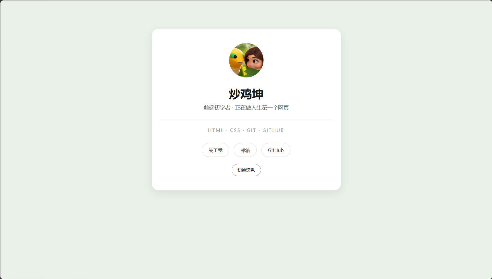
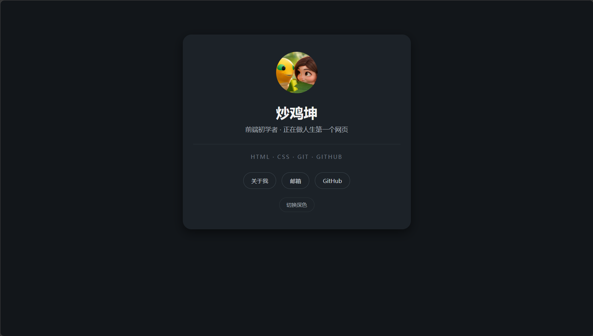

# 炒鸡坤的名片

我的第一个网页作品：一张单页个人名片，支持深色模式。

## 在线预览

https://chaojikun666.github.io/first-hub/

## 功能

- 卡片式布局，电脑与手机自适应（520px 断点）
- 深色模式一键切换，刷新后记住选择（localStorage）
- 纯 CSS 进场动画，无任何第三方库
- 两页：名片页 + 关于我

## 技术栈

HTML / CSS / 原生 JavaScript（零框架、零依赖）

## 文件结构

```
first-hub/
├── index.html      名片页
├── about.html      关于我
├── style.css       样式表（两页共用）
├── script.js       主题切换（两页共用）
├── images/
│   └── avatar.png  头像
└── README.md
```

**结构 / 样式 / 行为 三层分开**：两个 HTML 共用同一份 `style.css` 和 `script.js`，改一处两页同时生效。

## 技术要点

| 用到的 | 说明 |
| --- | --- |
| CSS 变量 | 所有颜色集中在 `:root` 里定义，深色模式只换一套变量值 |
| 响应式 | `@media (max-width: 520px)` 断点 + `viewport` |
| 主题切换 | `<html>` 上加/删 `dark` 类，CSS 负责画样子 |
| 状态持久化 | `localStorage` 记住上次选的主题 |
| 动画 | `@keyframes` + `transform` / `opacity`（不触发重排） |

## 截图

<!-- 把截图放进 images/ 目录，替换下面两行的文件名 -->





## 踩过的坑

记录真实踩过的，供以后复习：

1. **`.card` 写成 `card`（少了点）** —— CSS 不报错，只是静默失效。
2. **以为 `text-align: center` 能让卡片居中** —— 它只管文字；盒子居中靠 `margin: 0 auto`。
3. **`href` 里少了 `mailto:`** —— 浏览器当成相对路径，点邮箱跳 404。
4. **Windows 隐藏文件扩展名** —— 命名 `avatar.png` 得到 `avatar.png.png`，导致图片 404。
5. **CSS 规则顺序** —— `.avatar` 写在 `@media` 后面，手机端尺寸被覆盖。
6. **深色模式漏了 `.text`** —— 正文深灰配深背景，对比度过低几乎看不见。
7. **改了 CSS 变量没生效** —— DevTools 还开着深色模拟，浅色变量被暗色那套盖住。

## 我学到什么

- 盒模型、CSS 变量、媒体查询与响应式布局
- CSS 的继承与优先级（"后写的赢"只在分数相同时成立）
- 用 JavaScript 操作 `classList` 改变页面状态
- 用 `localStorage` 保存用户选择
- Git 提交、推送与 GitHub Pages 部署
- 结构 / 样式 / 行为分离的工程习惯

## 更新记录

- 2026-10-18 初始化仓库，添加 README
- 2026-10-20 完成 HTML 骨架、卡片布局与配色
- 2026-10-21 拆出独立 `style.css`
- 2026-10-23 新增「关于我」页面，共用样式表
- 2026-10-24 引入 CSS 变量，新增深色模式
- 2026-10-29 新增主题切换按钮与本地持久化

## 下一步

复刻小米官网首屏（P02），补上布局能力：Flex、Grid、`position: fixed`。
